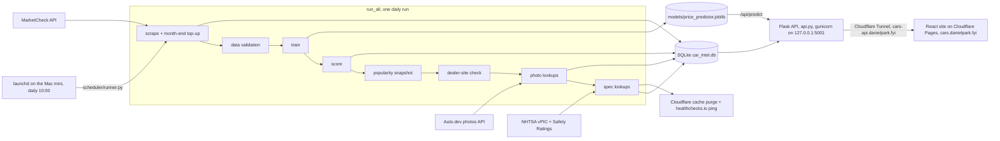

# Car Intel

A used car market intelligence pipeline that ingests live listings from the Marketcheck API, trains a price model to estimate fair market value, and scores each listing as a deal (0-100). A Flask API serves the results to a React dashboard.

---

## Results

Four model families are trained on the same features and the same split: **Linear Regression**, a custom **Relaxed Lasso** (LassoCV variable selection, then an unregularized OLS refit on the selected variables), **Random Forest**, and **XGBoost**.

**Evaluation setup** (`_vin_split` and `train` in `ml/pipeline.py`, `training_pool_v` in `db/models.py`):
- Rows come from the `training_pool_v` SQL view: price $3k-100k, mileage 0-400k, `days_listed` <= 365, last seen within 180 days, and **one row per VIN** (the latest snapshot). Dealers relist the same car under a new listing id, usually after a price cut, so without this the test set contains near-identical twins of training cars.
- Train/validation/test split **grouped by VIN** (`GroupShuffleSplit`, seed 42): test is 20% of cars, validation is 20% of the rest (64/16/20). No VIN appears in more than one split; the audit script asserts this and records the overlap counts (all 0).
- The **test split is used once, for reporting.** The model is selected on validation MAE, and the bias-correction offset (`log_calibration`, median log residual) is fit on validation.
- Target: `log1p(price)`, converted back with `expm1` minus the calibration offset, as production serves it.

**Held-out test results**, from [`outputs/holdout_metrics.json`](outputs/holdout_metrics.json), produced by `scripts/holdout_audit.py` (9,605 unique cars as of 2026-10-15; 6,147 train, 1,537 val, 1,921 test). Median abs % error is `median(|pred - true| / true)`. Price segments filter on the **true** asking price.

| Model | Val MAE | Test MAE | Median abs % error | $20-35k (n=622) | < $10k (n=222) |
|---|---|---|---|---|---|
| Linear | $5,763 | $5,528 | 15.1% | 13.3% | 29.1% |
| Relaxed Lasso | $5,157 | $5,069 | 13.8% | 11.2% | 22.3% |
| Random Forest | $3,958 | $3,968 | 9.6% (95% CI 8.9-10.4) | 8.0% (7.0-9.2) | 20.1% |
| **XGBoost (selected)** | **$3,413** | **$3,363** | **8.2% (95% CI 7.6-8.7)** | **6.8% (6.2-7.5)** | **13.2%** |

CIs are percentile bootstraps over the test set (2,000 resamples). XGBoost is selected because it has the lowest validation MAE, and it also has the lowest test error in every segment but over $60k. Its margin over Random Forest is significant: the paired bootstrap CI for the difference in median error is -2.2 to -0.8 points overall and -2.2 to -0.2 points in the $20-35k segment. XGBoost averages 5 seeds and uses squared error on the log price (see `TECHNICAL_README.md` 14.2 and 14.9).

Caveats:
- The target is the dealer's **asking** price, not a sale price, so "error" means distance from the asking price.
- One random split of cars listed over the same period, not a time-ordered backtest. It measures fair value for current inventory, not forecasting.
- Segment n is small (254 cars under $10k), and the scheduled job retrains on newer data every run, so the live model's error will drift from these figures. Re-run the script to refresh them.
- The database is not committed (Marketcheck data), so the numbers reproduce only from the same DB snapshot. `rows_sha256` in the results file fingerprints the rows that were evaluated.

Earlier versions of this README reported much lower error figures. Those are retracted: they came from re-splitting a live database with a random, non-VIN-grouped split, which put training cars (and relisted twins of them) into the test set.

**Serving latency**, from `scripts/latency_bench.py` on an Apple M5 laptop (localhost, one sequential client, Flask server as started by `start.py`):

| Endpoint | p50 | p95 |
|---|---|---|
| `/api/predict` (live model inference) | 10.2 ms | 10.7 ms |
| `/api/deals?limit=100` (precomputed scores) | 13.8 ms | 16.6 ms |
| `/api/deals?min_score=0` (dashboard, all 12,843 graded listings) | 461 ms | 496 ms |

A full rescoring pass over 14,737 listings takes 0.2 s. Writing the scores to SQLite adds about 2 s.

---

## Architecture



**Ingestion** (`scraper/data_ingest.py`, `scraper/api_usage.py`) pulls active listings from the MarketCheck REST API (no HTML scraping), rotating through configured search targets (`config/search_targets.json`) and zip codes, and tracks the monthly call quota. Each listing keeps the first https dealer photo MarketCheck sends.

**Enrichment** runs after scoring, and a failure in any of these steps never fails the run:
- `scraper/dealer_sites.py` checks each dealer website is reachable; the API hides ads whose site is down.
- `scraper/vehicle_photos.py` asks Auto.dev for a photo for listings MarketCheck sent without one: up to 30 calls a night (`PHOTOS_DAILY_CALLS`), newest first, inside the free plan's 1,000 a month. A VIN with no photo is retried after 14 days. A later MarketCheck photo replaces the Auto.dev one.
- `scraper/vehicle_specs.py` fetches free NHTSA data for the listing page's spec sheet: a VIN decode (engine, safety equipment, weight), dimensions and crash-test ratings by year/make/model. Up to 300 calls a night (`SPECS_DAILY_CALLS`); `scheduler/runner.py --specs` backfills with no cap.

**Storage** (`db/models.py`, `db/repository.py`) is a SQLite database via SQLAlchemy:

| Table | Holds |
|---|---|
| `car_listings` | One row per listing, upserted by `listing_id`; stale listings are marked inactive, not deleted |
| `price_history` | A row each time a listing's price is first seen or changes (seeded 2026-11-08 with the then-current prices) |
| `predictions` | Every scoring run's predicted price, deal score and model version |
| `popularity_snapshots` | Daily counts and prices per year/make/model cohort |
| `vin_specs`, `model_specs` | Cached NHTSA data, per VIN pattern and per year/make/model |
| `vin_photos` | Which VINs Auto.dev was asked about, and whether it had a photo |

**Scheduled run** (`scheduler/runner.py`) runs scrape, validation, train, score, popularity snapshot and the enrichment steps in sequence, then purges the Cloudflare cache so the site shows the new data and pings healthchecks.io, which emails if a run is late or fails. In production a launchd daemon starts it daily (see Running in production below).

**Modeling** (`ml/pipeline.py`) builds engineered features (vehicle age, mileage transforms, cohort medians, luxury/body-type flags, one-hot categoricals), trains and compares the four model families above, and persists the winner with its metrics and calibration offset.

**API** (`api.py`) is a Flask app that reads from SQLite and the saved model to serve deals, spec sheets, stats, trends and on-demand predictions.

**Website** (`frontend/src/car-intel-dashboard.jsx`) is a React app with four views, each with its own URL: home (search and top deals), listings (filters and sort), one listing (photo, price grade, facts, spec sheet, similar cars) and price check (an estimate and range for any make, model, year and mileage). Shared parts are in `frontend/src/components/`, and the colours, fonts and motion timings are tokens in `frontend/src/theme.css`, with light and dark themes. It calls the API at `REACT_APP_API_URL` (defaults to `http://localhost:5001/api`).

### Running in production

The pipeline, API and dashboard run unattended on an always-on Mac mini as three macOS LaunchDaemons, so they start at boot without anyone logging in. The plists, setup and install scripts are in [`deploy/macmini/`](deploy/macmini/README.md).

| Service | launchd label | What it runs |
|---|---|---|
| Pipeline | `com.carintel.pipeline` | `scheduler/runner.py` at boot and daily at 10:00 local time: scrape → data validation → train → score → popularity snapshot → dealer-site check → photo lookups → spec lookups → cache purge |
| API | `com.carintel.api` | `api.py` under gunicorn on 127.0.0.1:5001, restarted if it exits; public at https://cars-api.danielpark.fyi through a Cloudflare Tunnel |
| Dashboard | Cloudflare Pages | https://cars.danielpark.fyi, rebuilt on every push to `main` |

Each run makes up to 15 Marketcheck calls (5 each for cars, pickups and SUVs, around one of 15 rotating western-US zip codes), about 450 a month. The free plan stops at 500, and so does the scraper's monthly budget (`MARKETCHECK_MONTHLY_BUDGET`); a run that reaches it carries on with the data it has. On the last day of the month (New York time) the run repeats the scrape until the budget is spent, so calls the daily runs left unused (~50 a month, more after downtime) aren't wasted. A full run takes about 2.5 minutes: ~17 s of Marketcheck calls, ~2 min to grid-search and train the four models plus the 5 out-of-fold models, and a few seconds to rescore the active listings (~22,000 as of 2026-11-08). The photo and spec lookups then add a few minutes, paced to each API's rate limit. Each run appends one row to `logs/scrape_log.csv` (new / updated / active listings), `logs/training_log.csv` (model version, row counts, every candidate's test MAE, chosen XGBoost hyperparameters) and `logs/validation_log.csv` (data-quality counts from `db/validation.sql`). The full run log goes to `logs/launchd_stderr.log`. The database, model and live logs stay on the machine and are not committed.

[`outputs/run_history/`](outputs/run_history/) is a snapshot of those three CSVs as of 2026-10-16: every scheduled run since April 2026. Timestamps are UTC. Training rows before 2026-09-29 show lower MAE because they used the retracted random, non-VIN-grouped split (see Results), and runs before 2026-10-14 used the earlier model configuration.

---

## API Reference

| Method | Endpoint | Purpose | Example response shape |
|---|---|---|---|
| GET | `/api/deals` | Graded listings, best deal first. Query: `limit` (default: all), `min_score`, `make`, `model`, `body` | `[{"listing_id": "...", "year": 2021, "make": "Honda", "model": "Accord", "price": 22000, "predicted_price": 23800, "savings": 1800, "deal_score": 72.5, "deal_label": "3 Stars", "mileage": 34000, ...}]` |
| GET | `/api/specs` | Spec sheet for one listing, from cached NHTSA data. Required: `id` (a `listing_id`). Empty list until the pipeline has fetched that car's data; 404 for an unknown id | `[{"group": "Engine", "rows": [["Power", "182 hp"], ...]}]` |
| GET | `/api/popular` | Most-listed year/make/model cohorts. Query: `limit` | `[{"rank": 1, "year": 2022, "make": "Toyota", "model": "Camry", "active_listings": 88, "avg_price": 26500, "median_price": 25900, ...}]` |
| GET | `/api/stats` | Global market snapshot | `{"active_listings": 12854, "graded_listings": 12843, "makes": 47, "models": 612, "avg_price": 27431.2, "price_min": 3100, "price_max": 99500, "last_updated": "2026-09-21T00:00:00Z"}` |
| GET | `/api/trends` | Avg price by month for the top 5 makes over the last 7 months | `{"data": [{"month": "Mar", "toyota": 25100, "honda": 23900}], "makes": ["Toyota", "Honda", ...]}` |
| GET | `/api/listings` | Graded active listings (sampled to 800) for the price vs. mileage scatter plot | `[{"year": 2020, "make": "Ford", "model": "F-150", "price": 31000, "mileage": 41000, "deal_score": 61.0, "deal_label": "Fair Price", ...}]` |
| GET | `/api/predict` | On-demand price prediction. Required: `make`, `model`, `year`, `mileage`. Optional: `trim`, `accident_count`, `owner_count`, `state` | `{"predicted_price": 24310.0}` |


---

## Deal Scoring

Each listing's asking price is compared to the model's predicted fair value, and the gap is measured in units of **how wrong the model typically is at that price** (`_segment_errors` and `_deal_score_from_prices` in `ml/pipeline.py`). Only listings priced at or above `MIN_PRICE` ($3,000, `db/models.py:80`) are scored and shown: the model is trained on nothing cheaper.

```
diff_pct = (predicted_price - actual_price) / predicted_price * 100
z        = diff_pct / segment_error      # segment_error: median abs % error for this price band and cohort size
score    = clamp(50 + 40 * z / 3, 0, 100)
```

`segment_error` is the selected model's median absolute % error per price band (under $10k, $10-20k, $20-35k, $35-60k, over $60k, by asking price) and, within each band, per cohort size: how many other-dealer training cars share the listing's make, model and year (under 3, 3-9, 10+). A cell with under 30 rows falls back to its band's error. The errors come from the validation split plus the training cars' out-of-fold predictions, and are saved with the model at every retrain. On the current snapshot band errors run from about 7% ($20-35k) to 20% (under $10k). Rare cars get a wider yardstick because the model is much less sure about them; with one error per band they got 4+ stars about 3x as often as common cars.

Cars the model trained on are scored with an **out-of-fold** prediction: one of 5 models trained without that VIN. Scored with the final model, which fits them closely, they hardly ever looked like deals.

5 Stars needs a discount of at least **3x the band's typical error**. For roughly normal errors the median absolute error is about 0.67 sigma, so 3x is about 2 sigma: fewer than 1 in 40 fairly priced cars should look that cheap from model error alone. The same 20% discount is therefore 5 Stars on a $25k car (typical error ~7%) but only 3 Stars on an $8k car (~20%). Cheap cars stay listed and graded; they just need a much bigger discount before the grade claims a steal. On the current snapshot this cut 5-Star listings from 210 (73% under $10k) to 119 (2 under $10k).

A model saved before per-band errors existed falls back to a flat scale with 5 Stars at a 32% discount, which is the original formula (`50 + 1.25 * diff_pct`).

| Score | Label |
|---|---|
| 90-100 | 5 Stars |
| 75-89 | 4 Stars |
| 60-74 | 3 Stars |
| 45-59 | 2 Stars |
| 0-44 | 1 Star |

The website groups the same score into five plain-word grades of its own (`frontend/src/utils/scoreColor.js`), set so anything within about one typical error of the estimate reads as fair:

| Score | Grade on the site |
|---|---|
| 90-100 | Great deal |
| 65-89 | Good deal |
| 35-64 | Fair price |
| 15-34 | High price |
| 0-14 | Overpriced |

---

## Setup

The database and trained model are not committed (see Limitations). You need your own Marketcheck API key to populate them.

```bash
# 1. Create a virtual environment
python3 -m venv venv
source venv/bin/activate

# 2. Install dependencies
pip install -r requirements.txt

# 3. Configure environment
cp .env.example .env
# edit .env: set MARKETCHECK_API_KEY (required), optionally MARKETCHECK_ZIP / MARKETCHECK_RADIUS / PORT

# 4. Build the database and train a model from scratch
PYTHONPATH=. python3 scheduler/runner.py --scrape-only   # ingest listings into a fresh car_intel.db
PYTHONPATH=. python3 scheduler/runner.py --train-only    # train and save models/price_predictor.joblib
PYTHONPATH=. python3 scheduler/runner.py --score-only    # score listings with deal_score / predicted_price

# 5. Start the API
PYTHONPATH=. python3 api.py    # http://localhost:5001

# 6. Start the frontend
cd frontend
npm install
cp .env.example .env   # optional, only needed if the API isn't on localhost:5001
npm start
```

### Scheduling

On macOS, `deploy/macmini/setup.sh` and `install.sh` install the scheduled pipeline (see Running in production). Check a run with `launchctl print system/com.carintel.pipeline` (`runs`, `last exit code`) and `tail logs/launchd_stderr.log`. The job runs the repo's `venv/bin/python3`, so the virtualenv must exist; without it launchd fails with exit code 78. Elsewhere, the cron equivalent is:

```cron
# crontab -e — daily, like the launchd job
0 3 * * * cd /path/to/Car-Price-Predictor && PYTHONPATH=. venv/bin/python3 scheduler/runner.py >> logs/cron.log 2>&1
```

---

## Limitations and Next Steps

- Test coverage is one assert-based script (`tests/test_eval.py`: VIN-grouped split, scoring price floor, deal-score scaling, cohort features, API call budget, spec sheets, photo lookups, price history) and one frontend test (`frontend/src/components/Select.test.jsx`), not CI. `scripts/test_marketcheck_endpoints.py` is a standalone smoke script.
- The deal score is a simple linear heuristic on predicted-vs-actual price gap. It isn't calibrated against actual sale outcomes.
- The model doesn't see vehicle condition or options data, since Marketcheck doesn't return either in structured form. This is the largest known gap versus production pricing tools.
- Retraining depends on a single always-on machine (sleep disabled by `install.sh`); there's no failover if it's off, and no alerting if a run fails. The run log and `launchctl print` are the only signals.
- The saved model is a single `models/price_predictor.joblib` file with no versioning or rollback if a bad training run gets deployed.
- `requirements.txt` includes `gunicorn`, but neither `Procfile` nor `render.yaml` currently invoke it; both run the Flask dev server directly.

---

## Repo Structure

```
Car-Price-Predictor/
├── api.py                        # Flask REST API (port 5001)
├── start.py                      # Startup wrapper used by Procfile/render.yaml
├── requirements.txt
├── .env.example                  # Backend environment variables
├── config/
│   ├── search_targets.json       # Scrape target definitions (zip rotation, body types)
│   └── trim_rankings.json        # Trim-level ranking data used in feature engineering
├── scraper/
│   ├── data_ingest.py            # MarketCheck API client, upserts into SQLite
│   ├── api_usage.py              # MarketCheck call quota tracking
│   ├── dealer_sites.py           # Which dealer websites are down
│   ├── vehicle_photos.py         # Auto.dev photos for listings without one
│   └── vehicle_specs.py          # NHTSA spec sheets for the listing page
├── db/
│   ├── models.py                 # SQLAlchemy models (the seven tables above) and the training view
│   ├── repository.py             # Query/CRUD layer
│   └── validation.sql            # Data-quality checks logged on every run
├── ml/
│   └── pipeline.py               # Feature engineering, training, scoring, popularity snapshots
├── scheduler/
│   └── runner.py                 # Orchestrates the daily run (see Architecture)
├── scripts/
│   ├── holdout_audit.py          # Held-out test metrics (outputs/holdout_metrics.json)
│   ├── model_sanity_check.py     # Directional/sanity checks on model predictions
│   ├── score_audit.py            # Deal score distribution report
│   ├── autodev_photo_trial.py    # One-off check of Auto.dev photo coverage
│   └── ...                       # Experiments, benchmarks and endpoint smoke tests
├── research/                     # Research notes behind data-source and model decisions
├── deploy/macmini/               # LaunchDaemon plists + setup/install scripts for the always-on host
├── outputs/
│   ├── holdout_metrics.json      # Held-out test results (scripts/holdout_audit.py)
│   └── run_history/              # Snapshot of the run logs
├── tests/
│   └── test_eval.py              # Assert-based checks (see Limitations)
├── frontend/
│   ├── .env.example              # Frontend environment variables (REACT_APP_API_URL)
│   ├── public/                   # index.html, theme-init.js, _headers (CSP for Cloudflare Pages)
│   └── src/
│       ├── car-intel-dashboard.jsx  # The four views and URL routing
│       ├── theme.css             # Design tokens, light and dark
│       ├── index.css             # Component styles
│       ├── components/           # Listing card, deal pill, Select menu, theme toggle
│       └── utils/                # Formatting and deal-grade helpers
└── data/                         # Runtime state (API usage counters, scrape cursors), gitignored
```
